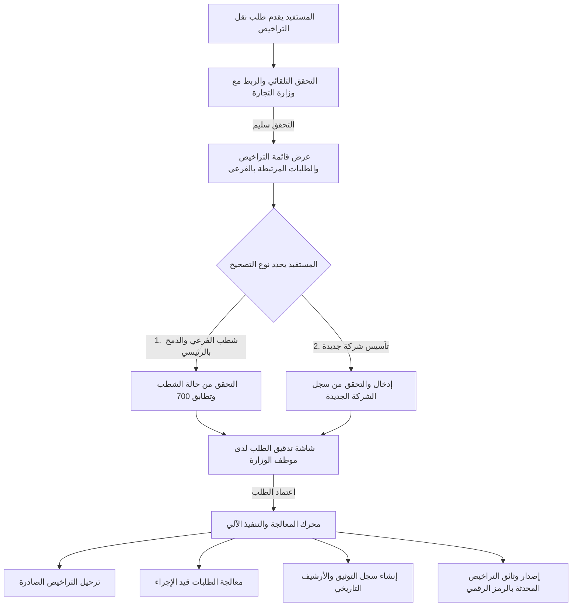
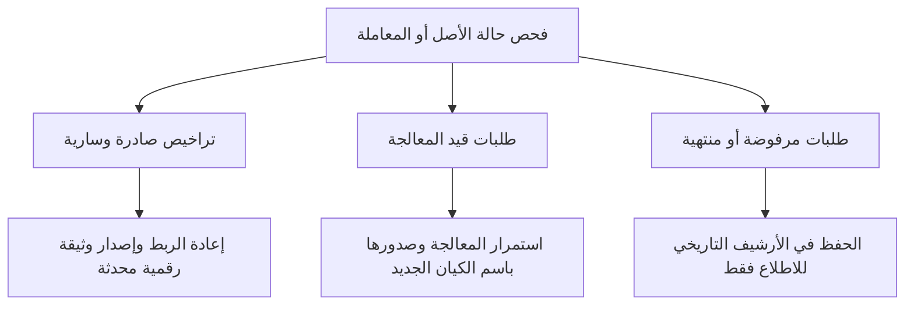

# وثيقة تحليل المتطلبات والحل التقني: حوكمة تصحيح ونقل تراخيص السجلات التجارية الفرعية

**النظام المستهدف:** خدمات منصة "نما" — وزارة البيئة والمياه والزراعة  
**المرجع النظامي:** قرار معالي وزير التجارة رقم (288) وتاريخ 20/09/1446هـ، والتوجيه القانوني الصادر بالخطاب رقم (25232816)  
**الحالة:** المسودة المعمارية التنفيذية المعتمدة

---

## 1. المقدمة ونطاق العمل والأهداف

يهدف هذا المشروع إلى بناء حل متكامل لجميع خدمات منصة "نما" لمعالجة الآثار المترتبة على إلغاء مفهوم السجلات التجارية الفرعية وفق التنظيم الجديد لوزارة التجارة. يركز الحل على:
1. **تمكين نقل وربط التراخيص والموافقات والخدمات** وفق مساري التصحيح الأساسيين (شطب السجل الفرعي والدمج في السجل الرئيسي، أو تحويل السجل وتأسيس شركة جديدة).
2. **الحفاظ التام على الأرشيف والبيانات التاريخية** للسجل الفرعي لضمان الحجية القانونية وسجلات التفتيش والرقابة.
3. **معالجة كافة حالات الطلبات** (سواء كانت تراخيص صادرة سارية، أو طلبات لا تزال قيد الدراسة والتفتيش، أو طلبات جديدة).

---

## 2. المسارات النظامية المعتمدة للتصحيح

| المسار | الوصف النظامي | أثر التراخيص والموافقات | الكيان المستهدف الجديد |
| :--- | :--- | :--- | :--- |
| **المسار الأول (الأساس والأكثر شيوعاً)** | **شطب السجل التجاري الفرعي** | تنتقل التراخيص والأنشطة وتُربط **بالسجل التجاري الرئيسي** تلقائياً وفق الفقرة (ج) من البند 3. | السجل التجاري الرئيسي القائم لنفس المنشأة (تطابق الرقم الموحد 700). |
| **المسار الثاني** | **تحويل السجل بتأسيس شركة جديدة** | ترتبط التراخيص والموافقات **بالشركة الجديدة** المؤسسة المستقلة. | سجل تجاري جديد لشركة برقم موحد 700 جديد. |

---

## 3. المعمارية الوظيفية للخدمة المقترحة في منصة "نما"

يتم إنشاء خدمة جديدة موحدة باسم:  
**`خدمة تصحيح ونقل التراخيص والخدمات المرتبطة بالسجلات التجارية`**



### دورة عمل الخدمة ومراحلها:
1. **التحقق المسبق من سياق الحساب عند الدخول:**
   * يتعرف النظام آلياً على السجل التجاري الحالي في الجلسة، ويشترط أن يكون **سجلاً فرعياً** (يرفض النظام تقديم الطلب إذا كان السجل رئيسياً أو غير مصنف).
   * يظهر في الشاشة رقم السجل التجاري واسم السجل واسم الشركة الأم دون الحاجة لاختيار السجل.

2. **اختيار مسار التصحيح والتحقق الآلي:**
   * **مسار (1) الشطب والدمج بالرئيسي:**
     * التحقق اللحظي من وزارة التجارة أن السجل الفرعي **مشطوب رسمياً**.
     * التحقق من تبعية السجل الرئيسي للفرعي وتطابق الرقم الموحد (700) وعرض رقم واسم السجل الرئيسي.
     * **عرض قائمة الأنشطة الاقتصادية:** عرض أنشطة السجل الفرعي والرئيسي (للعرض فقط) مع إجراء **مطابقة آلية للأنشطة** للتأكد من أن السجل الرئيسي يتضمن الأنشطة الاقتصادية التابعة للتراخيص المنقولة.
     * **التحقق من وجود السجل الرئيسي في منصة نما:** إذا كان غير مسجل، تظهر رسالة نظامية *(يجب تسجيل بيانات الشركة الرئيسية في منصة نما أولاً)* ويتم **منع استكمال الطلب**.
   * **مسار (2) تأسيس شركة جديدة:**
     * إدخال رقم سجل الشركة الجديدة المؤسسة والتحقق من سريانه.
     * **التحقق من وجود سجل الشركة الجديدة في منصة نما:** إذا كان السجل غير مسجل في نما، تظهر رسالة نظامية توضح ذلك *(يجب تسجيل وتفعيل بيانات الشركة الجديدة في منصة نما أولاً)* ويتم **منع استكمال الطلب** حتى استيفاء التسجيل وتعيين المفوض.
     * **التحقق ومطابقة الأنشطة الاقتصادية للشركة الجديدة:** عرض قائمة أنشطة الشركة الجديدة (للعرض فقط) والتأكد آلياً من أنها تتضمن الأنشطة الزراعية الموازية للتراخيص المطلوب نقلها قبل إحالة المعاملة لاعتماد الوزارة.

3. **آلية الاعتماد والموافقات:**
   * **في مسار الشطب والدمج بالرئيسي:** يُرسل الطلب مباشرة إلى **المفوض النظامي للسجل التجاري الرئيسي** عبر منصة نما؛ وبمجرد دخوله واعتماده للموافقة، **يتم النقل فورياً وبشكل آلي دون الحاجة لأي موافقة يدوية من موظفي الوزارة**.
   * **في مسار تأسيس شركة جديدة (اعتماد مرحلي مزدوج):**
     1. **المرحلة الأولى (موافقة مفوض الشركة الجديدة):** بعد إرسال الطلب، يُحال أولاً إلى **المفوض النظامي للشركة الجديدة** للدخول على منصة نما والموافقة الرسمية على استلام التراخيص والمسؤوليات النظامية.
     2. **المرحلة الثانية (دراسة واعتماد الوزارة):** فور موافقة مفوض الشركة الجديدة، تُحال المعاملة تلقائياً إلى **موظف الوزارة المختص** (إدارة التراخيص)، حيث تعرض الشاشة تفاصيل الطلب كاملاً، متضمنةً:
        * بيانات السجل الفرعي المحال منه والسجل الجديد المحال إليه وقوائم الأنشطة ومطابقتها.
        * التراخيص والطلبات المشمولة بالنقل.
        * **توثيق موافقة الشركة الجديدة وتاريخ ووقت الموافقة بالثانية والختم الرقمي**.
        * حقل لتدوين ملاحظات وتوصيات الموظف.
        * **خيارات قرار موظف الوزارة الثلاثة:**
          - 🟢 **قبول الطلب:** اعتماد نقل التراخيص رسمياً وإصدار الشهادات المحدثة برمز الاستجابة السريعة المعتمد.
          - 🟡 **إرجاع الطلب إلى مقدم الطلب لاستكمال النواقص:** مع بيان الملاحظات.
          - 🔴 **رفض الطلب:** مع بيان الأسباب والمسوغات النظامية.

---

## 4. مصفوفة معالجة الطلبات والتراخيص بجميع حالاتها

توضح المصفوفة الآتية كيفية تصرف النظام مع كل حالة من حالات الأصول الرقمية للشركة:



| نوع وحالة السجل في المنصة | الحالة التشغيلية | المعالجة الفنية والإجرائية في النظام | النتيجة النهائية |
| :--- | :--- | :--- | :--- |
| **1. التراخيص والموافقات الصادرة** | سارية ونشطة | عند اعتماد النقل، يقوم محرك البيانات بإعادة ربط التراخيص وتحديث رمز التحقق الرقمي والشهادة الرقمية باسم السجل المستهدف. | تظهر فوراً في لوحة تحكم السجل الرئيسي/الجديد، مع حفظ مرجع للسجل السابق. |
| **2. الطلبات قيد الإجراء (مثل: شهادة سعودي قاب)** | قيد المعالجة | يستمر موظف الوزارة في دراسة الطلب فنياً دون انقطاع. يتم آلياً نقل ملكية الطلب إلى الشركة الجديدة/السجل الرئيسي. | تظهر في حساب مفوضي الشركة الجديدة ويُمنحون صلاحية استكمال الرد على النواقص باسم الكيان الجديد. |
| **3. الطلبات قيد التفتيش والزيارة الميدانية** | قيد التفتيش والمعاينة | تظل زيارة المفتش قائمة على الموقع الفعلي (الإحداثيات/العنوان الجغرافي لا تتغير). يُسجل التقرير لمفوضي الكيان الجديد. | يتابع مفوضو الشركة الجديدة موعد الزيارة مع المفتش واعتماد المحضر. |
| **4. الطلبات في مرحلة سداد الفاتورة المالية (سداد)** | بانتظار السداد | تظل فاتورة سداد الصادرة بالرقم المالي سارية الدفع دون إلغاء. | يُتاح لمفوضي الشركة الجديدة سداد الفاتورة، وبمجرد السداد يُصدر الترخيص باسم السجل الجديد. |
| **5. التراخيص المنتهية أو الملغاة سابقاً** | منتهية أو ملغاة | تُقفل ولا تُنقل كسجلات نشطة، بل تُنقل إلى تبويب **"الأرشيف التاريخي"** للكيان الجديد. | الاطلاع فقط مع الاحتفاظ بكامل السجلات والمخالفات السابقة. |
| **6. التقديم على طلبات جديدة تماماً** | طلب جديد | يُمنع المستفيد برمجياً من اختيار أي سجل فرعي مشطوب للتقديم على خدمات جديدة. | حظر تام، وإجبار المستفيد على التقديم عبر السجل النشط الجديد. |

---

## 5. حوكمة الصلاحيات وإدارة السجل بعد الموافقة

> [!IMPORTANT]
> **قواعد الحظر وإيقاف المفوضين وانتقال الصلاحيات فور صدور الموافقة:**
> فور صدور الموافقة على طلب الدمج والتصحيح (موافقة مفوض السجل الرئيسي آلياً في مسار الدمج، أو موافقة موظف الوزارة النهائي في مسار الشركة الجديدة)، يُطبق النظام آلياً الإجراءات التالية:

### 1. حظر التعامل على السجل التجاري الفرعي:
* **تجميد الحساب وحظر التعامل:** يتم تحويل حالة السجل الفرعي في منصة "نما" فوراً إلى **`محظور التعامل / مصحح بالدمج`**.
* **إغلاق تقديم المعاملات:** يُحظر برمجياً وبشكل قطعي فتح أي طلب خدمة جديد، أو تجديد رخصة، أو إصدار تصاريح بيئية أو زراعية، أو تقديم أي معاملة جديدة عبر هذا السجل الفرعي نهائياً.
* **إشعار النظام:** عند محاولة الدخول أو الاستعلام عن السجل، تظهر رسالة نظامية مانعة: *(تم تصحيح وضع هذا السجل الفرعي بالدمج/التحويل وحظر التعامل عليه، وانتقلت كافة الالتزامات والتراخيص إلى السجل رقم X)*.

### 2. إيقاف وتجميد جميع المفوضين على السجل الفرعي:
* **تعطيل الصلاحيات فورياً:** يقوم النظام آلياً بإيقاف وتعطيل ارتباط كافة المفوضين المعتمدين على السجل التجاري الفرعي (موقوف بسبب الدمج).
* **إسقاط السجل من لوحة المفوضين:** يُحذف السجل الفرعي من القائمة المنسدلة لاختيار المنشآت في حسابات جميع المفوضين السابقين، بحيث لا يمكنهم اختياره أو تمثيله في أي إجراء.
* **إبطال التفويضات والتواقيع:** تُسحب كافة صلاحيات التوقيع الإلكتروني أو التفويض الإداري أو المالي المعلقة التي كانت ممنوحة على السجل الفرعي، حمايةً للمنشأة ومنعاً لأي تصرفات غير نظامية.

### 3. انتقال الطلبات الجاري معالجتها وتمكين مفوضي الشركة الجديدة من استكمالها:
* **الترحيل التلقائي لكافة المعاملات النشطة:** كافة الطلبات التي لا تزال جارية وتحت المعالجة (الطلبات قيد المراجعة الفنية، الطلبات بانتظار استكمال النواقص، الطلبات بانتظار الزيارة الميدانية، الطلبات بانتظار سداد الفواتير المالية) تُرحل بالكامل إلى السجل التجاري الجديد (أو السجل الرئيسي).
* **تمكين مفوضي الشركة الجديدة من المتابعة والإنجاز:**
  يُمنح المفوضون النظاميون المعتمدون للشركة الجديدة (أو السجل الرئيسي) عبر منصة "نما" كامل الصلاحيات لاستكمال دورة العمل على هذه الطلبات، وتتضمن:
  1. **الرد على النواقص:** استعراض طلبات الاستكمال والملاحظات الفنية المرسلة من مهندسي الوزارة، ورفع المرفقات والمستندات المطلوبة باسم الكيان الجديد.
  2. **السداد المالي للمعاملات:** الوصول إلى فواتير "سداد" الخاصة بالطلبات الجاري معالجتها وسدادها مباشرة.
  3. **متابعة الزيارات والتفتيش الميداني:** استقبال إشعارات الزيارات الميدانية والتنسيق مع المفتشين واعتماد تقارير المعاينة.
  4. **استلام التراخيص المعتمدة:** بمجرد اعتماد الطلب النهائي، يُصدر الترخيص تلقائياً ببيانات ورقم الشركة الجديدة ويتاح لمفوضيها تحميل الوثيقة الرقمية فوراً.

---

## 6. استراتيجية الاحتفاظ بالبيانات القديمة وتتبعها

> [!IMPORTANT]
> **قاعدة معمارية صارمة:** يُحظر إجراء مسح أو استبدال صلب للبيانات القديمة لقيمة السجل الفرعي، وذلك لحفظ الحجية القانونية لتقارير التفتيش، الإرساليات الجمركية، والشهادات السابقة.

### هيكل حفظ البيانات والربط العلائقي:
1. **الاحتفاظ بالرقم المعرف الفريد الثابت:**
   * رقم الترخيص الوطني أو رقم التسجيل يظل ثابتاً، وما يتغير هو الكيان المالك.
2. **جدول سجل التتبع التاريخي:**
   * يُسجل كل حدث انتقال بالتفصيل:
     * نوع الإجراء: تم النقل بالشطب والدمج في الرئيسي / تأسيس شركة جديدة.
     * رقم السجل المنقول منه.
     * رقم السجل المنقول إليه.
     * اسم ومعرّف الموظف الذي اعتمد النقل.
     * التاريخ والوقت بالثانية.
     * السند النظامي: رقم قرار وزارة التجارة وتاريخه.
3. **عرض البيانات للمفتشين والجهات الرقابية:**
   * عند قيام مفتش الوزارة بمسح الرمز الرقمي المعتمد (الباركود الذكي) لأي ترخيص أو شحنة زراعية قديمة، تظهر له شاشة تتضمن:
     > *"الترخيص حالياً تابع للسجل الرئيسي رقم (X)، وكان مقيداً سابقاً على السجل الفرعي رقم (Y) قبل تصحيح الوضع بتاريخ (...)"*.

---

## 7. نموذج قواعد البيانات المقترح

```sql
-- 1. جدول تسجيل عمليات نقل وتصحيح السجلات
CREATE TABLE CR_Correction_Requests (
    Request_ID VARCHAR(30) PRIMARY KEY,
    Source_CR_Number VARCHAR(20) NOT NULL,          -- رقم السجل الفرعي القديم
    Target_CR_Number VARCHAR(20) NOT NULL,          -- رقم السجل المستهدف (الرئيسي/الجديد)
    Unified_National_Number VARCHAR(20),            -- الرقم الموحد 700
    Correction_Type ENUM('MERGE_MAIN', 'NEW_COMPANY') NOT NULL, -- شطب ودمج في الرئيسي / تأسيس شركة جديدة
    Status ENUM('SUBMITTED', 'UNDER_REVIEW', 'APPROVED', 'REJECTED') DEFAULT 'SUBMITTED',
    Reviewer_User_ID VARCHAR(50),
    Review_Comments TEXT,
    Approval_Date TIMESTAMP NULL,
    Created_At TIMESTAMP DEFAULT CURRENT_TIMESTAMP
);

-- 2. جدول تتبع حركة الأصول (تراخيص، موافقات، شحنات، طلبات)
CREATE TABLE Asset_Transition_Audit (
    Audit_ID BIGINT AUTO_INCREMENT PRIMARY KEY,
    Request_ID VARCHAR(30) NOT NULL,
    Asset_Type ENUM('LICENSE', 'REGISTRATION', 'IN_PROGRESS_REQUEST', 'PERMIT') NOT NULL,
    Asset_Identifier VARCHAR(50) NOT NULL,          -- مثل رقم الترخيص أو رقم طلب الخدمة
    Old_CR_Number VARCHAR(20) NOT NULL,
    New_CR_Number VARCHAR(20) NOT NULL,
    Transition_Status ENUM('SUCCESS', 'FAILED') DEFAULT 'SUCCESS',
    Transition_Date TIMESTAMP DEFAULT CURRENT_TIMESTAMP,
    FOREIGN KEY (Request_ID) REFERENCES CR_Correction_Requests(Request_ID)
);

-- 3. العمليات الآلية المنفذة فور اعتماد الطلب
-- أ) حظر التعامل على السجل الفرعي:
UPDATE CR_Accounts 
SET Account_Status = 'BLOCKED_MERGED', 
    Blocked_Reason = 'Consolidated into Target CR pursuant to Commerce Decision No. 288',
    Blocked_Date = CURRENT_TIMESTAMP 
WHERE CR_Number = :Source_CR_Number;

-- ب) إيقاف وتجميد صلاحيات كافة المفوضين على السجل الفرعي:
UPDATE User_Delegations 
SET Delegation_Status = 'SUSPENDED_BY_MERGER', 
    Revocation_Date = CURRENT_TIMESTAMP,
    Revocation_Reason = 'Branch CR Merged / Liquidated'
WHERE CR_Number = :Source_CR_Number;

-- ج) نقل وتوجيه الطلبات الجاري معالجتها إلى مفوضي السجل الجديد للاستكمال:
UPDATE Service_Requests 
SET CR_Number = :Target_CR_Number,
    Delegation_Group = 'TARGET_CR_DELEGATES',
    Updated_At = CURRENT_TIMESTAMP
WHERE CR_Number = :Source_CR_Number 
  AND Request_Status IN ('UNDER_REVIEW', 'PENDING_APPLICANT', 'INSPECTION_SCHEDULED', 'PENDING_PAYMENT');
```

---

## 8. خارطة طريق التنفيذ


1. **المرحلة الأولى: إطلاق خدمة النقل والاعتماد اليدوي الموجه (2 أسبوع):**
   * إطلاق واجهة الطلب للمستفيدين لاختيار التراخيص.
   * لوحة تحكم لموظفي الشؤون الزراعية/القانونية لتدقيق واعتماد نقل التراخيص الصادرة.
2. **المرحلة الثانية: محرك معالجة الطلبات قيد الإجراء (1 أسبوع):**
   * ضبط محرك سير العمل بحيث يتم تحويل إصدار الشهادات تلقائياً للسجل الجديد لحظة الاعتماد النهائي للطلبات المفتوحة.
3. **المرحلة الثالثة: الربط الآلي الكامل والتنبيهات (1 أسبوع):**
   * تفعيل الفحص التلقائي اللحظي لحالة السجل عبر التكامل مع وزارة التجارة.
   * إرسال إشعارات للشركات التي شطبت سجلاتها لتذكيرها بتقديم طلب نقل التراخيص.
